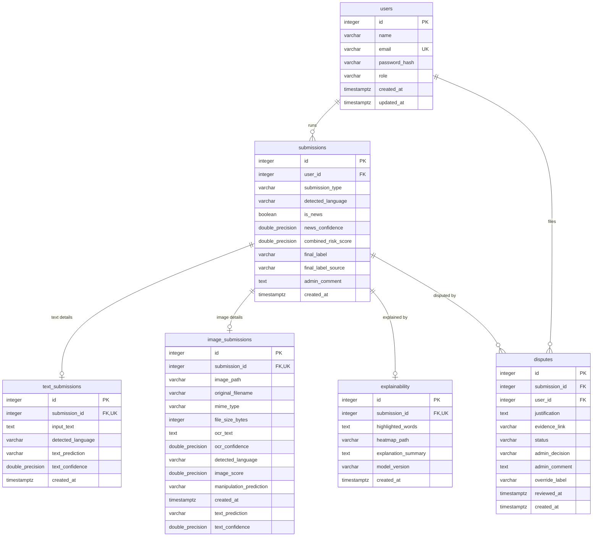

# KhabarNazar database schema

> **Generated file.** Do not edit by hand. After changing the database (a new Alembic migration), run
> `.\.venv\Scripts\python.exe scripts\describe_database.py` from `backend/` to regenerate it.
> For the database's live state (row counts, latest activity) run the same script with `--summary`.

| | |
|---|---|
| Database | PostgreSQL 17.11 (`khabarnazar`; tests use `khabarnazar_test`) |
| Migration revision | `d2e7b4c19a35` (latest) |
| Tables | 6 application tables + `alembic_version` |
| Managed by | SQLAlchemy models in `backend/app/models/`, changed only through Alembic migrations in `backend/alembic/versions/` |

## How the tables fit together

Every check a user runs creates **one `submissions` row** (the outcome) plus exactly one details row (**`text_submissions`** *or* **`image_submissions`**) and one **`explainability`** row (the reasons). **`disputes`** are added later if the user challenges the verdict. Deleting a user deletes their checks and disputes; deleting a check deletes its details, explanation and disputes (`ON DELETE CASCADE`).

Diagram key: `||--o{` one-to-many, `||--o|` one-to-(zero or one). PK primary key, FK foreign key, UK unique.

## Tables

### `users`

Registered accounts. One row per person who can sign in.

| Column | Type | Null? | Key | Meaning |
|---|---|---|---|---|
| `id` | INTEGER | no | PK | Unique account number, assigned automatically. |
| `name` | VARCHAR(100) | no |  | Display name, 2–100 characters (leading/trailing spaces removed). |
| `email` | VARCHAR(255) | no | UNIQUE | Login email, stored in lower case. Unique: two accounts can never share one. |
| `password_hash` | VARCHAR(255) | no |  | bcrypt hash of the password (never the password itself). Never sent to the app. |
| `role` | VARCHAR(20) | no |  | `user` or `admin`. New accounts are always `user`; only `scripts/set_user_role.py` changes it. |
| `created_at` | TIMESTAMPTZ | no |  | When the account was created (UTC). |
| `updated_at` | TIMESTAMPTZ | no |  | When the account row last changed (UTC); updated automatically. |

**Indexes:** `ix_users_email` (email, unique); `ix_users_id` (id)

### `submissions`

One row per check a user runs (text or image). This is the parent record that holds the outcome shown to the user; the details live in `text_submissions` or `image_submissions`, and the reasons in `explainability`.

| Column | Type | Null? | Key | Meaning |
|---|---|---|---|---|
| `id` | INTEGER | no | PK | Unique check number, assigned automatically. Used in app links such as `/result/42`. |
| `user_id` | INTEGER | no | FK → users.id | The account that ran the check. Deleting the account deletes its checks. |
| `submission_type` | VARCHAR(20) | no |  | `text` or `image` (`both` is reserved and not used yet). |
| `detected_language` | VARCHAR(50) | yes |  | Language of the text, or of the text read from the image: `urdu`, `roman_urdu`, `english`, `mixed` or `unknown`. Empty if there was no text. |
| `is_news` | BOOLEAN | yes |  | Whether the content is news. Empty until a news/non-news classifier is connected (never guessed). |
| `news_confidence` | DOUBLE PRECISION | yes |  | Confidence of that news/non-news decision, 0–1. Empty until the classifier exists. |
| `combined_risk_score` | DOUBLE PRECISION | yes |  | Estimated chance the content is fake, 0–1: the text model's probability of Fake (weight 0.7) combined with the image score (weight 0.3), using only the signals that exist. Empty when no model produced a signal. |
| `final_label` | VARCHAR(50) | no |  | The verdict shown to the user: `Fake`, `Real` or `Uncertain`. An admin override replaces the AI's label. |
| `final_label_source` | VARCHAR(50) | no |  | Who set `final_label`: `AI` or `Admin`. |
| `admin_comment` | TEXT | yes |  | Comment from the most recent admin review of this check, if any. |
| `created_at` | TIMESTAMPTZ | no |  | When the check was run (UTC). |

**Links:** `user_id` → `users.id` (on delete: cascade)

**Indexes:** `ix_submissions_id` (id); `ix_submissions_user_id` (user_id)

### `text_submissions`

The text that was checked, and the text model's result. Exactly one per text check.

| Column | Type | Null? | Key | Meaning |
|---|---|---|---|---|
| `id` | INTEGER | no | PK | Unique row number, assigned automatically. |
| `submission_id` | INTEGER | no | FK → submissions.id, UNIQUE | The check this text belongs to (one-to-one). Deleted with the check. |
| `input_text` | TEXT | no |  | The text as submitted, 3–10,000 characters. |
| `detected_language` | VARCHAR(50) | yes |  | `urdu`, `roman_urdu`, `english`, `mixed` or `unknown`. |
| `text_prediction` | VARCHAR(50) | yes |  | The text model's label: `Fake`, `Real` or `Uncertain` (`Uncertain` while no model is trained). |
| `text_confidence` | DOUBLE PRECISION | yes |  | How sure the model is of its own label, 0–1. This is not the risk score. Empty while no model is trained. |
| `created_at` | TIMESTAMPTZ | no |  | When the row was saved (UTC). |

**Links:** `submission_id` → `submissions.id` (on delete: cascade)

**Indexes:** `ix_text_submissions_id` (id); `text_submissions_submission_id_key` (submission_id, unique)

### `image_submissions`

The uploaded image and its results. Exactly one per image check. The two image signals are kept separate on purpose: text read from the image (OCR + text model) and whether the image itself looks manipulated.

| Column | Type | Null? | Key | Meaning |
|---|---|---|---|---|
| `id` | INTEGER | no | PK | Unique row number, assigned automatically. |
| `submission_id` | INTEGER | no | FK → submissions.id, UNIQUE | The check this image belongs to (one-to-one). Deleted with the check. |
| `image_path` | VARCHAR(512) | no |  | File name of the stored image inside `backend/uploads/` (a random name, never the user's). The image file itself is not in the database. |
| `original_filename` | VARCHAR(255) | yes |  | The file name on the user's device, kept for display only (max 255 characters). |
| `mime_type` | VARCHAR(100) | yes |  | Image type detected from the file's contents: `image/jpeg`, `image/png` or `image/webp`. |
| `file_size_bytes` | INTEGER | yes |  | Size of the uploaded file in bytes (maximum 10 MB). |
| `ocr_text` | TEXT | yes |  | Text read from the image by OCR. Empty if OCR is not installed or found no text. |
| `ocr_confidence` | DOUBLE PRECISION | yes |  | Average OCR confidence for that text, 0–1. |
| `detected_language` | VARCHAR(50) | yes |  | Language of the OCR text (same values as for text checks). |
| `image_score` | DOUBLE PRECISION | yes |  | Image manipulation / AI-generated score, 0–1. Empty until an image model is connected. |
| `manipulation_prediction` | VARCHAR(50) | yes |  | Short label from the image model (max 50 characters). Currently `Not Analyzed`. |
| `created_at` | TIMESTAMPTZ | no |  | When the row was saved (UTC). |
| `text_prediction` | VARCHAR(50) | yes |  | The text model's label for the OCR text, if there was text: `Fake`, `Real` or `Uncertain`. |
| `text_confidence` | DOUBLE PRECISION | yes |  | How sure the text model is of that label, 0–1. Empty while no model is trained. |

**Links:** `submission_id` → `submissions.id` (on delete: cascade)

**Indexes:** `image_submissions_submission_id_key` (submission_id, unique); `ix_image_submissions_id` (id)

### `explainability`

Why the result came out as it did. Exactly one per check.

| Column | Type | Null? | Key | Meaning |
|---|---|---|---|---|
| `id` | INTEGER | no | PK | Unique row number, assigned automatically. |
| `submission_id` | INTEGER | no | FK → submissions.id, UNIQUE | The check this explanation belongs to (one-to-one). Deleted with the check. |
| `highlighted_words` | TEXT | yes |  | JSON text: a list of `{word, contribution, direction}` showing which words pushed the text model's score. Empty when no model is trained. These are model attributions, not fact-checks. |
| `heatmap_path` | VARCHAR(512) | yes |  | Heatmap image inside `backend/uploads/` (`explanations/<id>_heatmap.png`). Empty unless an image model supplies one. |
| `explanation_summary` | TEXT | yes |  | Plain-language summary shown on the result screen, including what was unavailable and why. |
| `model_version` | VARCHAR(50) | yes |  | Which analysis produced the result, e.g. `text-tfidf-logreg`, `text-model-unavailable`, `easyocr-ur-en`, `ocr-unavailable`. |
| `created_at` | TIMESTAMPTZ | no |  | When the row was saved (UTC). |

**Links:** `submission_id` → `submissions.id` (on delete: cascade)

**Indexes:** `explainability_submission_id_key` (submission_id, unique); `ix_explainability_id` (id)

### `disputes`

A user challenging a verdict, and the admin's decision. A check can be disputed more than once (only one may be pending at a time).

| Column | Type | Null? | Key | Meaning |
|---|---|---|---|---|
| `id` | INTEGER | no | PK | Unique dispute number, assigned automatically. |
| `submission_id` | INTEGER | no | FK → submissions.id | The check being disputed. Deleted with the check. |
| `user_id` | INTEGER | no | FK → users.id | The account that filed the dispute (always the check's owner). Deleted with the account. |
| `justification` | TEXT | no |  | The user's reason, 10–5,000 characters. |
| `evidence_link` | VARCHAR(512) | yes |  | Optional http(s) link to supporting evidence (max 512 characters). |
| `status` | VARCHAR(20) | no |  | `pending` until an admin decides, then `reviewed`. (`closed` is accepted as a filter but not set by the app.) |
| `admin_decision` | VARCHAR(20) | yes |  | `uphold_ai` (keep the AI verdict) or `override` (replace it). Empty while pending. |
| `admin_comment` | TEXT | yes |  | The admin's required comment explaining the decision. |
| `override_label` | VARCHAR(50) | yes |  | With `override`: the new verdict, `Fake`, `Real` or `Uncertain`. Copied to `submissions.final_label`. |
| `reviewed_at` | TIMESTAMPTZ | yes |  | When the admin decided (UTC). Empty while pending. |
| `created_at` | TIMESTAMPTZ | no |  | When the dispute was filed (UTC). |

**Links:** `submission_id` → `submissions.id` (on delete: cascade); `user_id` → `users.id` (on delete: cascade)

**Indexes:** `ix_disputes_id` (id); `ix_disputes_submission_id` (submission_id); `ix_disputes_user_id` (user_id)

### `alembic_version`

Bookkeeping for Alembic, the migration tool: one row holding the migration revision this database is at.

| Column | Type | Null? | Key | Meaning |
|---|---|---|---|---|
| `version_num` | VARCHAR(32) | no | PK | The current migration revision ID (compare with the migration history below). |

## Allowed values

These columns are plain text in the database; the API (Pydantic schemas and services) only ever writes these values.

| Column | Values |
|---|---|
| `users.role` | `user`, `admin` |
| `submissions.submission_type` | `text`, `image` (`both` reserved) |
| `submissions.final_label, text_submissions.text_prediction, image_submissions.text_prediction` | `Fake`, `Real`, `Uncertain` |
| `submissions.final_label_source` | `AI`, `Admin` |
| `*.detected_language` | `urdu`, `roman_urdu`, `english`, `mixed`, `unknown` |
| `image_submissions.mime_type` | `image/jpeg`, `image/png`, `image/webp` |
| `disputes.status` | `pending`, `reviewed` (`closed` reserved) |
| `disputes.admin_decision` | `uphold_ai`, `override` |
| `disputes.override_label` | `Fake`, `Real`, `Uncertain` |

## Notes

- **Times** are stored as `TIMESTAMPTZ` (with time zone) and written in UTC; the app converts them to the phone's local time.
- **Files are not stored in the database.** Uploaded images and heatmaps live in `backend/uploads/`; the database keeps only their file names.
- **Empty means "not evaluated".** Scores and labels that need an AI model stay empty (NULL) until that model is connected; nothing is invented.
- **Secrets:** `password_hash` is a one-way bcrypt hash. The database password itself lives only in `backend/.env`.
- The `ix_<table>_id` indexes duplicate the primary-key indexes (they come from `index=True` on the models' `id` columns). They are harmless.

## Migration history

Applied in this order by `alembic upgrade head`:

| # | Revision | What it did |
|---|---|---|
| 1 | `79aafe1355a3` | create_users_table |
| 2 | `a4c8d2e91b07` | create_submission_tables |
| 3 | `c81f2a9b6714` | add extracted text prediction fields to image submissions |
| 4 | `d2e7b4c19a35` | store timestamps with time zone; make is_news nullable |

## Useful commands (from `backend/`)

| Task | Command |
|---|---|
| Live status (migration level, row counts, latest activity) | `.\.venv\Scripts\python.exe scripts\describe_database.py --summary` |
| Bring the database up to date | `.\.venv\Scripts\python.exe -m alembic upgrade head` |
| Which migration is the database at? | `.\.venv\Scripts\python.exe -m alembic current` |
| Do the models match the migrations? | `.\.venv\Scripts\python.exe -m alembic check` |
| Regenerate this document and `schema.sql` | `.\.venv\Scripts\python.exe scripts\describe_database.py` |
| Is this document still accurate? | `.\.venv\Scripts\python.exe scripts\describe_database.py --check` |

The exact SQL that creates every table and index is in [`schema.sql`](schema.sql).
